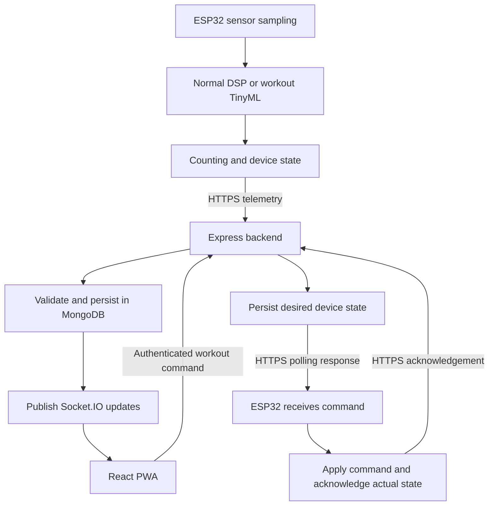

# gerak.In Repository Structure and Implementation Guide

> Status: recommended architecture and implementation guidelines, not an implemented scaffold.
> This guide complements the existing project brief, database schema proposal, and PWA UI specification. It does not imply that the folders or features below already exist.

## 1. Purpose and scope

Build the complete gerak.In system in one repository, with dedicated folders for each major component:

- ESP32 production firmware and supporting ESP32 utilities.
- TinyML data preparation, model evaluation, and deployment records.
- Backend API, persistence, device control, and real-time updates.
- React Progressive Web App (PWA).
- Shared communication contracts, hardware documentation, deployment configuration, and tests.

The system is an armband fitness tracker based on a Seeed Studio XIAO ESP32C3 and an MPU-6050 or compatible six-axis IMU.

### Operational modes

| Mode | Device processing | Expected output |
| --- | --- | --- |
| Normal | Lightweight local DSP | Sitting/idle, walking, running, and step counts |
| Workout | Edge Impulse-exported TinyML inference plus repetition-counting logic | Push-up, jumping jack, or rest classification; confidence; completed repetitions |

The backend calculates estimated calories. The PWA displays daily activity, controls workouts, receives live updates, and shows saved session summaries.

## 2. Recommended architecture

Use a **lightweight monorepo**: one Git repository containing independently buildable components.

- **Firmware:** C++ with PlatformIO as the recommended build/upload tool. Verify the framework and inference library against the exact ESP32C3 board before committing to them.
- **Backend:** Node.js, TypeScript, Express, Mongoose, and Socket.IO.
- **PWA:** React, TypeScript, Vite, and a compatible PWA integration.
- **Database:** MongoDB.
- **ML:** Edge Impulse training/export workflow, with local utilities only where useful.
- **Deployment:** Ubuntu laptop, MongoDB, backend service, and Tailscale Funnel for public HTTPS access.
- **Node package management:** npm workspaces with one root lockfile.

TypeScript and PlatformIO are recommendations added by this guide, rather than requirements established by the original brief. Select supported versions and pin dependencies during implementation.

Do not introduce microservices, Kubernetes, a message broker, or heavyweight monorepo orchestration without a demonstrated need.

### Communication flow



Socket.IO is the backend-to-PWA real-time channel. The proposed ESP32 channel remains HTTPS telemetry and command polling; an ESP32 Socket.IO client is not required.

## 3. Recommended folder structure

This tree is a target layout. Create folders when their implementation is needed, rather than generating empty scaffolding for every entry.

```text
gerak.In/
├── README.md
├── REPOSITORY_GUIDE.md
├── .gitignore
├── .editorconfig
├── package.json                    # Node workspaces and common commands
├── package-lock.json               # Shared Node workspace lockfile
│
├── apps/
│   ├── backend/
│   │   ├── src/
│   │   │   ├── config/             # Validated environment configuration
│   │   │   ├── db/                 # MongoDB connection and lifecycle
│   │   │   ├── middleware/         # Authentication, validation, errors
│   │   │   ├── modules/
│   │   │   │   ├── telemetry/      # Ingestion and activity logs
│   │   │   │   ├── devices/        # Device status, commands, acknowledgements
│   │   │   │   ├── workouts/       # Session lifecycle and summaries
│   │   │   │   └── activity/       # Daily totals and calorie estimation
│   │   │   ├── realtime/          # Socket.IO setup and subscriptions
│   │   │   ├── app.ts             # Express app, independently testable
│   │   │   └── server.ts          # HTTP server and startup/shutdown
│   │   ├── tests/
│   │   ├── .env.example
│   │   └── package.json
│   │
│   └── pwa/
│       ├── public/                 # Static assets and install icons
│       ├── src/
│       │   ├── app/                # Routing, providers, application shell
│       │   ├── features/
│       │   │   ├── dashboard/
│       │   │   ├── workouts/
│       │   │   └── device-status/
│       │   ├── components/         # Reusable UI components
│       │   ├── lib/                # HTTP and Socket.IO clients
│       │   ├── styles/             # Global styles and design tokens
│       │   └── assets/
│       ├── tests/
│       ├── vite.config.ts          # Build and PWA integration
│       ├── .env.example
│       └── package.json
│
├── firmware/
│   ├── wearable/                   # Main deployable device application
│   │   ├── src/
│   │   │   ├── sensors/            # IMU sampling and calibration
│   │   │   ├── activity/           # Normal-mode DSP and step counting
│   │   │   ├── inference/          # TinyML integration
│   │   │   ├── workout/            # Rep counting and workout state
│   │   │   ├── connectivity/       # Wi-Fi, HTTPS, retrying, command polling
│   │   │   ├── state/              # Device state and mode transitions
│   │   │   └── main.cpp
│   │   ├── include/                # Headers and configuration templates
│   │   ├── lib/                    # Pinned exported inference library
│   │   ├── test/
│   │   └── platformio.ini
│   ├── tools/
│   │   ├── imu-calibration/        # Standalone calibration firmware
│   │   └── data-collection/        # Standalone training-data firmware
│   └── README.md                   # Board setup, build, flash, monitoring
│
├── ml/
│   ├── README.md                   # Data-to-deployment workflow
│   ├── data/                       # Dataset metadata and manifests
│   ├── scripts/                    # Conversion and validation utilities
│   ├── experiments/                # Training settings and experiment notes
│   └── evaluation/                 # Metrics and evaluation reports
│
├── packages/
│   └── contracts/
│       ├── schemas/                # Telemetry, commands, socket payloads
│       ├── src/                    # Shared TypeScript types and validators
│       ├── examples/               # Valid sample JSON payloads
│       └── package.json
│
├── hardware/
│   ├── wiring/
│   ├── enclosure/
│   └── bom.md                      # Bill of materials and power notes
│
├── infra/
│   ├── compose.yaml                # MongoDB and optional backend container
│   ├── tailscale/                  # Funnel setup instructions
│   └── systemd/                    # Optional Ubuntu service definitions
│
├── docs/
│   ├── requirements/               # Project brief and schema proposal
│   ├── architecture/               # System/data flow and state machines
│   ├── api/                        # HTTP and Socket.IO documentation
│   ├── design/                     # UI specification and references
│   ├── setup/                      # Development, deployment, demo guides
│   └── decisions/                  # Short architecture decision records
│
├── tests/
│   └── e2e/                        # Cross-component system tests
├── scripts/                        # Repository-wide development utilities
└── .github/
    └── workflows/                  # Automated checks
```

## 4. Component boundaries and ownership

### 4.1 Backend: `apps/backend/`

Owns:

- Request authentication and runtime payload validation.
- Telemetry deduplication and persistence.
- Device registration/status and desired versus reported mode.
- Workout start/stop lifecycle and durable summaries.
- Calorie estimates and daily activity aggregation.
- Authorized Socket.IO subscriptions and update delivery.

Keep each feature's routes, services, models, and validation near that feature. Do not split the backend into separate network services.

Keep MongoDB models, index definitions, and maintenance utilities with the backend. MongoDB runtime configuration belongs in `infra/`, not in a separate database application.

### 4.2 PWA: `apps/pwa/`

Owns:

- Dashboard, workout setup, active workout, and summary screens.
- HTTP requests and Socket.IO subscriptions.
- Installability, application-shell caching, and offline indicators.
- Consistent design tokens based on the provided UI specification.

Distinguish browser-to-server connection status from the device's last-seen status. A connected socket does not prove that the wearable is online.

### 4.3 Production firmware: `firmware/wearable/`

Use **one production firmware application** with both operating modes. Switching modes must not require reflashing the device.

Separate sampling, signal processing, inference, counting, networking, and device state. Network latency must not interrupt the sampling cadence required by the model.

Supporting utilities under `firmware/tools/` may be independent PlatformIO projects when needed. Avoid maintaining duplicate copies of substantial sensor logic; extract shared firmware code only when actual reuse justifies it.

### 4.4 ML workflow: `ml/`

Owns dataset descriptions, training configuration, experiment records, evaluation, and model provenance. It is not a second copy of the deployed firmware library.

The firmware's `lib/` contains the exact exported inference library used for the device build, subject to its license and practical repository size. If that export is too large to commit, pin an immutable artifact and checksum and document how the build retrieves it.

### 4.5 Shared contracts: `packages/contracts/`

Owns public interface definitions, including:

- Telemetry requests and responses.
- Device commands and acknowledgements.
- Session identifiers and status payloads.
- Socket.IO event names and payloads.
- Canonical mode/activity labels and protocol versions.

Backend and PWA can share TypeScript definitions and runtime validators. ESP32 C++ implements the same JSON contract using documented schemas/examples; it cannot directly import TypeScript.

Do not expose Mongoose models as shared contracts. Database documents and external API representations have different responsibilities.

### 4.6 Supporting folders

- `hardware/`: wiring, verified pin mappings, power design, component list, enclosure files.
- `infra/`: reproducible service/deployment configuration; never credentials or database files.
- `docs/`: requirements, design, architecture, setup, and decisions.
- Component-local tests: unit and integration tests owned by that component.
- Root `tests/e2e/`: flows that exercise multiple components.
- Root `scripts/`: cross-component utilities, not application business logic.

## 5. Implementation guidelines

### 5.1 Define the protocol before connecting components

Resolve inconsistencies in the current proposals, such as `activity` versus `activityType` and `confidence` versus `confidenceScore`. Select one canonical wire format and explicitly map it to database fields.

Before implementation, define:

| Concern | Required decision |
| --- | --- |
| Identity | Stable device ID and authorization scope; session ID where applicable |
| Event uniqueness | Event ID or equivalent deduplication key that remains valid across retries/reboots |
| Counts | Incremental deltas versus cumulative totals, including reset rules |
| Time | Device occurrence time, server receipt time, and unsynchronized-clock behavior |
| Labels | Canonical values for modes, activities, and rest/idle |
| Confidence | Consistent scale and representation when inference does not apply |
| Versioning | Schema/protocol version and compatibility policy |
| Commands | Command ID/revision, target state, acknowledgement, and timeout behavior |
| Errors | Validation errors, retryable failures, and authentication failures |

An accepted telemetry retry must not count twice. If using cumulative totals, the backend must account for session boundaries, reboot/reset behavior, and out-of-order uploads rather than summing every snapshot.

The existing single `ActivityLog` collection is a useful starting point for activity events. Separate device-state and workout-session records are appropriate; one activity collection does not mean every domain object belongs in it.

### 5.2 Classification and counting are separate problems

A predicted `push_up` window does not necessarily mean that one complete push-up occurred. Likewise, a walking classification is not a step counter.

Implement and evaluate explicit step/rep counting, including debouncing, movement-cycle completion, overlapping inference windows, and transitions through rest. Validate using real recordings with ground-truth counts and the intended armband placement.

### 5.3 Use explicit device and session state

Track **desired mode** separately from **reported device mode**. The PWA should show a pending transition until the device acknowledges it.

Define:

- Workout/session creation and identifiers.
- Start and stop command acknowledgement.
- Repeated-command handling.
- Device disconnection, command timeout, and reboot behavior.
- Handling of telemetry arriving after a stop request.
- When a session becomes completed and its summary is durable.

Do not report “saved” solely because a user pressed a button. Confirm persistence, and distinguish completed sessions from interrupted or pending sessions.

### 5.4 Make networking resilient and secure

- Use HTTPS with certificate verification on the ESP32; do not disable verification for deployment.
- Tailscale Funnel provides public HTTPS exposure, not application-level authentication.
- Authenticate devices and authorize user controls and subscriptions.
- Scope real-time events to the authorized device/session; avoid unrestricted global broadcasts.
- Validate input sizes and values, apply reasonable rate limits, and avoid logging credentials.
- Retry transient failures with bounded backoff and preserve event identity across retries.
- Bound any telemetry queue according to device memory and document overflow behavior.
- Persist telemetry before broadcasting it as saved data.
- After socket reconnection, fetch authoritative state/history; real-time events alone are not durable delivery.
- Keep MongoDB private rather than exposing its port through Funnel.

Document polling intervals and their command-latency and battery implications. Do not promise zero-lag updates or low power without measurement.

### 5.5 Keep secrets out of Git

- Commit configuration templates, not real `.env` files or device credentials.
- Provide ignored local configuration or an explicit provisioning approach for ESP32 Wi-Fi and tokens.
- Never place backend secrets in the PWA. Vite client environment values are included in public browser code.
- Ignore build outputs, `.pio/`, dependency folders, local database volumes, and private datasets as appropriate.
- Keep reproducibility inputs such as lockfiles, toolchain settings, model version records, and safe example payloads.

### 5.6 Make TinyML deployment reproducible

Verify compatibility on the exact XIAO ESP32C3 before assuming a model/export will fit or run correctly.

Record for each deployed model:

- Edge Impulse project/export reference and model version/checksum.
- Exported library version and applicable license.
- Sensor axes, axis orientation, units, calibration, and sampling frequency.
- Input window length, overlap, preprocessing, and label order.
- Quantization/export settings and confidence thresholds.
- Evaluation dataset/split, per-class metrics, and confusion matrix.
- Device RAM/flash use and measured inference time.

Keep training, validation, and test recordings meaningfully separated to reduce leakage from adjacent windows or the same recording session.

Do not commit large raw recordings or repeated model archives into ordinary Git by default. Use dataset manifests and external artifact storage or Git LFS when justified. Keep any Python utility dependencies isolated and pinned when those utilities are introduced.

### 5.7 Present metrics honestly

- Model confidence is **not** measured accuracy. Replace the UI label “Avg AI Accuracy” with “Average Model Confidence” when displaying averaged inference scores.
- Do not present a normal-mode DSP result as 100% AI confidence. Prefer an explicit non-applicable value or separate signal-quality indicator.
- Label calories as estimates and document the calculation assumptions. Fixed calories-per-rep multipliers are demonstration approximations, not individualized physiological measurements.
- Store timestamps consistently, normally in UTC, and define the timezone used for “today” and daily aggregation.
- Add indexes based on actual query patterns and verify them rather than assuming every indexed query will be fast.

### 5.8 Design PWA offline behavior deliberately

Cache the interface and safe static assets for usability. Clearly distinguish cached/stale information from live data.

Do not silently queue start/stop workout controls unless delayed execution is explicitly designed and safe. When offline, show that the command could not be confirmed. Exclude authenticated API responses from indiscriminate service-worker caching.

Prefer serving the built PWA and API under one HTTPS origin for the initial laptop deployment where practical. Separate frontend hosting remains possible but requires explicit API URLs, CORS, authentication, and Socket.IO configuration.

### 5.9 Verify hardware and power assumptions

Document the exact board revision, IMU module, I2C pins/address, mounting orientation, and calibration procedure.

Validate the battery, charging/protection circuitry, regulator, and board power path against component documentation before assembly. Do not treat the brief's proposed TP4056/LDO arrangement as a verified schematic. Measure real current consumption and battery runtime in both modes.

## 6. Development tooling and validation

Use npm workspaces for `apps/backend`, `apps/pwa`, and `packages/contracts`. Keep firmware and optional ML tooling independently buildable; they do not need to become Node packages.

Add root convenience commands only after the underlying component commands exist. Keep component-specific instructions in their own README files.

Recommended validation layers:

| Layer | Priority checks |
| --- | --- |
| Contracts | Valid/invalid payloads, labels, versions, and serialization examples |
| Backend | Validation, authentication, deduplication, counting semantics, session lifecycle, persistence |
| PWA | Screen states, pending commands, disconnection, reconnection, stale data |
| Firmware | Build for the exact board, DSP/counting tests, malformed responses, reconnect/retry behavior |
| ML | Held-out classification metrics and ground-truth rep-count evaluation |
| End-to-end | Device/simulator → API → MongoDB → PWA; command → device acknowledgement |
| Hardware | Sampling stability, inference latency, memory use, battery runtime |

CI should run suitable linting, type checks, tests, and builds as components are introduced. Hardware-dependent checks should be documented separately when they cannot run in CI.

## 7. Existing document placement

These are proposed future moves, not actions performed by this guide.

| Current item | Recommended location |
| --- | --- |
| `README.md` | Keep at root as the main entry point |
| `REPOSITORY_GUIDE.md` | Keep at root and link from the README when documentation is reorganized |
| `project-brief.md` | `docs/requirements/project-brief.md` |
| `mongodb_schema_design_smart_fitness_tracker.md` | `docs/requirements/mongodb-schema-proposal.md` |
| `figma_ui_prompt_v2_dual_mode_edge_ai_fitness_tracker.md` | `docs/design/pwa-ui-spec.md` |
| `apple-iphone-11-black-mockup/` | `docs/design/mockups/` if its contents are design-only assets |
| `block_diagram_prompt.txt` | Review its contents before selecting an architecture/design documentation destination |

Preserve original requirements and clearly mark later amendments. Update relative links whenever files are moved. Keep the root README concise: project summary, architecture overview, links to setup instructions, and links to component documentation.

## 8. Suggested implementation order

1. **Resolve contracts and open decisions:** canonical labels, count semantics, device identity, sessions, commands, authentication, and time handling.
2. **Validate hardware and TinyML feasibility:** reliable IMU sampling, board/toolchain support, memory budget, and a minimal inference build on the actual ESP32C3.
3. **Build a thin vertical slice:** simulated or basic device telemetry → authenticated API → MongoDB → PWA live display.
4. **Implement Normal Mode:** DSP, step counting, daily aggregation, and measured operating behavior.
5. **Implement workout control:** acknowledged mode switching and session start/stop, initially with simulated classification if useful.
6. **Integrate evaluated TinyML and rep counting:** verify against recordings and real movement, not only synthetic payloads.
7. **Complete PWA behavior and deployment:** installation, offline indicators, reconnect recovery, Ubuntu service setup, and Funnel configuration.
8. **Validate the full demo:** device, server, and phone on separate networks; test retries, disconnects, restarts, duplicate telemetry, and interrupted sessions.

## 9. Decisions still to finalize

Before substantial implementation, document decisions for:

- Exact ESP32 framework, board configuration, and supported Edge Impulse export.
- Sampling frequency, window length, sensor orientation, and counting strategy.
- Incremental versus cumulative telemetry counts and deduplication rules.
- Device provisioning, user access, and authentication approach, including whether the initial deployment is single-user/single-device.
- Command polling frequency, acknowledgements, and timeout behavior.
- Offline telemetry buffering and data-retention limits.
- Initial frontend hosting: same-origin laptop deployment versus separate hosting.
- Dataset/artifact storage and model versioning.
- Calorie-estimation assumptions and daily timezone.

Use short records under `docs/decisions/` for choices that affect multiple components. The goal is reproducibility and clear boundaries, not documentation overhead.
