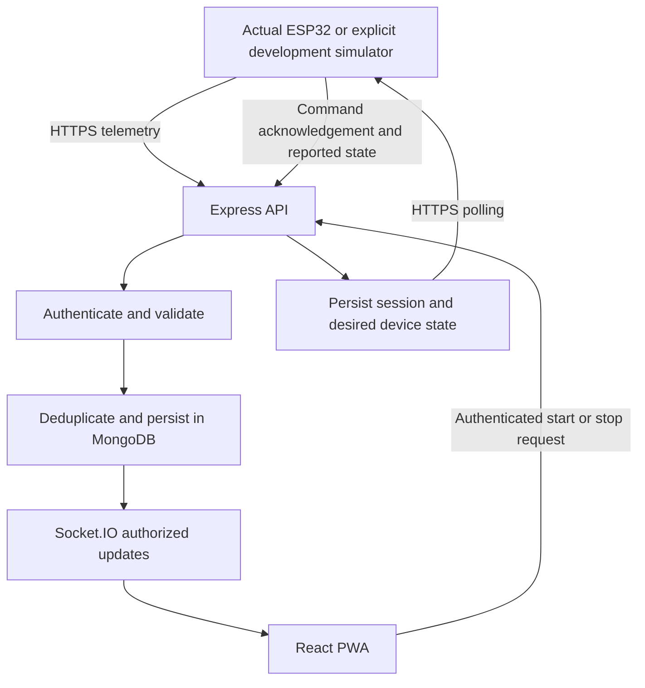

# gerak.In — Consolidated Project Brief and Agreed Setup

> **Status:** agreed implementation brief; not a claim that the system has been built or validated.
>
> This document consolidates the original requirements and subsequent scope decisions. Where it conflicts with earlier proposals, this document takes precedence. `REPOSITORY_GUIDE.md` remains supporting architectural guidance.
>
> Creating this document does not authorize application scaffolding, deployment, or hardware changes. Implementation starts only when explicitly requested.

## 1. Purpose and definition of completion

Build an academic prototype for a live demonstration: a single-owner, single-wearable fitness tracker integrating an ESP32, local signal processing and TinyML, a backend, MongoDB, and a React Progressive Web App.

The repository must contain the software and integration tools for the entire system, separated into dedicated folders. Include device and session identities so future expansion remains possible, without implementing a multi-user product now.

### Initial deliverable

- Reproducibly buildable software components and safe configuration examples.
- Backend authentication, telemetry ingestion, persistence, workout control, and live updates.
- Separate actual-hardware and PlatformIO/Wokwi firmware projects.
- A clearly labeled development simulator for application integration.
- Sensor data-collection firmware and a serial-to-CSV recording utility.
- A complete guide for collecting data, training/evaluating an Edge Impulse model, exporting it, and integrating it into the ESP32.
- A PWA implemented only after the owner supplies the Figma design material.
- Setup, deployment, database-change, Wokwi, testing, and troubleshooting documentation.

### Completion boundaries

Software builds and automated integration checks are different from physical validation. A simulator does not prove movement recognition, battery runtime, inference performance, or exercise-counting accuracy.

No trained model or dataset currently exists. Until an actual compatible model is supplied and tested, real-device workout inference must report **model unavailable**. The implementation must not claim that real TinyML classification is complete based on simulated predictions.

Subsequent debugging may cover software, TinyML integration, sensor behavior, and firmware. Physical evidence, logs, and recordings will be needed for hardware-dependent issues.

## 2. Confirmed decisions

| Area | Agreement |
| --- | --- |
| Intended use | Academic prototype/live demonstration |
| Ownership | One owner and one wearable initially |
| Actual hardware | Seeed Studio XIAO ESP32C3 and MPU-6050 |
| Placement | Left forearm, worn in a watch-like position |
| Firmware toolchain | PlatformIO with Arduino framework, subject to compatibility checks |
| Hardware projects | Separate real-device and Wokwi projects with shared reusable logic where practical |
| Normal Mode | Local DSP classification of idle, walking, running; separate step-counting logic |
| Workout classes | Jumping jack, squat, and rest |
| Exercise selection | Selected mode counts only the selected exercise; Auto-Detect counts both supported exercises separately |
| Workout controls | Start and Stop & Save; no Pause/Resume |
| Device transport | HTTPS telemetry and HTTPS command polling |
| Browser live transport | Socket.IO |
| Backend | Node.js, TypeScript, Express, Mongoose |
| Frontend | React, TypeScript, Vite, PWA integration |
| Database | MongoDB, private to the server deployment |
| Authentication | One configured owner login, no registration; separate device credential |
| Hosting | PWA, API, and Socket.IO through one Tailscale Funnel HTTPS origin |
| Timezone | Asia/Jakarta for daily views; UTC timestamp storage |
| Calories | Documented weight-and-duration-based estimates using configurable activity assumptions |
| Profile | Hardcoded/local demo profile including weight; no profile-management UI required |
| Secrets | Manually entered in ignored local configuration; safe templates committed |
| ML support | Documentation, collection firmware, serial recording tool, and a model integration path |
| Wokwi environment | VS Code extension alongside PlatformIO; setup guide required |
| Frontend timing | Wait for Figma material before PWA implementation |
| Node repository tooling | npm workspaces and one root lockfile |

## 3. Changes from the original documents

The following are intentional changes, not accidental deviations:

1. **Squat replaces push-up.** Workout labels are jumping jack, squat, and rest. Do not retain push-up as an implemented class merely because it appears in older documents.
2. Placement is specifically the **left forearm/watch position**, rather than an unspecified armband position.
3. Add separate real-device and Wokwi firmware projects.
4. Final UI design comes from forthcoming Figma material. The original UI prompt is a reference, not the final frontend specification.
5. Evolve the sample database design to include device state, sessions, deduplication, command acknowledgements, and duration-based estimates.
6. A non-AI DSP result must not be represented as 100% AI confidence.
7. Average model confidence must not be labeled model accuracy.
8. Do not use fixed calories-per-rep values as the agreed estimation method.
9. Keep credentials in ignored local configuration rather than tracked source files.
10. Public HTTPS exposure does not replace application authentication.
11. A trained TinyML artifact is a future input, not something already available.

## 4. System architecture



### Device to backend

The device sends lightweight telemetry when counts or relevant activity state change, with bounded batching if needed. Heartbeats/status updates allow the backend to distinguish an idle device from an unreachable one.

Do not send raw high-frequency IMU recordings to MongoDB as the default operational telemetry stream. Raw data collection is a separate development workflow.

### Backend to PWA

The backend validates and persists accepted data before publishing it as saved state. Socket.IO subscriptions must be authorized and scoped to the owner's device/session.

After reconnection, the PWA fetches authoritative state. Socket events are not a durable event history and must not be the only recovery mechanism.

### PWA to device

The browser submits an authenticated command to the backend. The backend records desired state; the device discovers it through polling, applies it, and acknowledges actual state.

A requested mode and the device's reported mode are separate values. The browser displays pending transitions instead of assuming immediate success.

## 5. Recommended repository layout

Create directories as they acquire real content. Do not generate empty structures solely to reproduce this tree.

```text
gerak.In/
├── README.md
├── project-brief-completed.md
├── REPOSITORY_GUIDE.md
├── .gitignore
├── .editorconfig
├── package.json
├── package-lock.json
│
├── apps/
│   ├── backend/
│   │   ├── src/
│   │   │   ├── config/
│   │   │   ├── db/
│   │   │   ├── middleware/
│   │   │   ├── modules/
│   │   │   │   ├── auth/
│   │   │   │   ├── devices/
│   │   │   │   ├── telemetry/
│   │   │   │   ├── workouts/
│   │   │   │   └── activity/
│   │   │   ├── realtime/
│   │   │   ├── app.ts
│   │   │   └── server.ts
│   │   ├── tests/
│   │   ├── .env.example
│   │   └── package.json
│   └── pwa/                         # Implement after Figma is supplied
│       ├── public/
│       ├── src/
│       │   ├── app/
│       │   ├── features/
│       │   ├── components/
│       │   ├── lib/
│       │   ├── styles/
│       │   └── assets/
│       ├── tests/
│       ├── vite.config.ts
│       ├── .env.example
│       └── package.json
│
├── firmware/
│   ├── wearable/                    # Actual XIAO ESP32C3 + MPU-6050
│   │   ├── src/
│   │   ├── include/
│   │   ├── lib/                     # Pinned model integration artifact
│   │   ├── test/
│   │   └── platformio.ini
│   ├── simulation/                  # Separate PlatformIO/Wokwi project
│   │   ├── src/
│   │   ├── include/
│   │   ├── platformio.ini
│   │   ├── wokwi.toml
│   │   └── diagram.json
│   ├── shared/                      # Reusable libraries when justified
│   ├── tools/
│   │   ├── imu-calibration/
│   │   └── data-collection/
│   └── README.md
│
├── ml/
│   ├── README.md
│   ├── data/                        # Metadata/manifests, not bulk raw data
│   ├── scripts/                     # Serial recording and CSV validation
│   ├── experiments/
│   └── evaluation/
│
├── packages/
│   └── contracts/
│       ├── schemas/
│       ├── src/
│       ├── examples/
│       └── package.json
│
├── tools/
│   └── device-simulator/            # Explicit software integration simulator
│
├── hardware/
│   ├── wiring/
│   ├── enclosure/
│   └── bom.md
├── infra/
│   ├── compose.yaml
│   ├── tailscale/
│   └── systemd/
├── docs/
│   ├── requirements/
│   ├── architecture/
│   ├── api/
│   ├── database/
│   ├── design/
│   ├── setup/
│   └── decisions/
├── tests/
│   └── e2e/
├── scripts/
└── .github/
    └── workflows/
```

### Boundary rules

- Use one backend application, not microservices.
- Use one actual-device production application with runtime mode switching, not separate Normal/Workout binaries.
- Keep the Wokwi project independently configurable and buildable. Share algorithms/protocol code where practical instead of maintaining divergent copies.
- Keep Mongoose models private to the backend. Share wire contracts, not database internals.
- TypeScript contracts cannot be directly imported into C++; provide schema examples and compatibility tests for firmware implementations.
- npm workspaces cover Node components. Firmware and optional Python tools remain independently buildable.
- No Kubernetes, message broker, or heavyweight monorepo framework is required.

## 6. Actual-device firmware

### Hardware baseline

- XIAO ESP32C3.
- MPU-6050 over I2C.
- Left forearm/watch-style placement with documented, repeatable orientation.
- Original power concept: approximately 400 mAh Li-Po and suitable charging/regulation circuitry. This is not a verified schematic.

Verify exact board revision, sensor module, pins, I2C address, power path, charger/protection arrangement, and voltage compatibility against component documentation before assembly. Do not assume that adding a TP4056 and LDO to the board is automatically safe or necessary.

### Logical firmware modules

- Sensor acquisition and calibration.
- Normal-mode DSP and separate step counting.
- TinyML model adapter and readiness status.
- Workout-specific movement-cycle counting.
- Device/session state machine.
- Wi-Fi/HTTPS, command polling, acknowledgement, retry handling, and bounded queues.

Networking must not destroy the sampling cadence required by inference. Avoid equating the number of classified windows with the number of completed repetitions.

### Normal Mode

Use lightweight variance/amplitude-based DSP, starting from the original approximately three-second analysis window. Thresholds, filtering, sampling, and step detection require calibration and testing.

Idle/walking/running are prototype classifications, not proven physiological states. Sitting cannot always be distinguished from other low-motion postures using a forearm IMU alone.

### Workout Mode

- Labels: jumping jack, squat, rest.
- Selected exercise: count only completed movements of that exercise.
- Auto-Detect: maintain separate totals for jumping jacks and squats.
- Rest is not a repetition-producing exercise.
- Use explicit movement-cycle detection/debouncing, informed by classification, rather than adding one repetition per inference window.
- Expose model availability and actual device mode independently.

Without a usable model, production firmware may still provide Normal Mode and connectivity, but must reject or clearly report unavailable AI workout capability. Do not acknowledge successful AI tracking when inference is unavailable.

## 7. Simulation strategy

### PlatformIO + Wokwi project

Use the Wokwi extension in VS Code alongside PlatformIO. Zed remains usable for repository editing; the Wokwi extension workflow runs in VS Code.

Verify current support for the exact XIAO board, MPU-6050, firmware artifacts, and networking before selecting the simulation configuration. If the exact XIAO board is unavailable, a supported ESP32 simulation board is permitted. Keep the actual firmware target unchanged.

Primary goal: integration simulation with controlled inputs and clearly labeled synthetic results. Add repeatable sensor inputs for real DSP/counting tests where feasible.

Do not imply that Wokwi reproduces real sensor noise, wearer movement, battery behavior, inference timing, or exact XIAO hardware characteristics.

### Software device simulator

Provide a separate development tool for deterministic API/control testing without hardware or a running Wokwi session. It should support telemetry, command acknowledgement, representative exercise events, retries, and disconnection scenarios as implemented.

Synthetic events must identify their source. The development simulator is not a production inference fallback, and its credentials/access must be deliberate rather than an authentication bypass.

### Required Wokwi guide

Create `docs/setup/wokwi-vscode.md` during implementation, covering:

- VS Code, PlatformIO, and Wokwi extension prerequisites.
- Account/license requirements applicable at that time.
- Opening the correct firmware project and building its artifacts.
- `wokwi.toml`, circuit configuration, and selected board/sensor support.
- Safe local Wi-Fi/backend configuration.
- Simulator internet access and any gateway/service restrictions.
- Connecting to the Funnel endpoint where supported.
- Running scenarios and reading serial output.
- Known differences from the real board and troubleshooting steps.

Do not promise working simulator networking until the chosen environment has been verified.

## 8. TinyML data and model workflow

No model training account, dataset, or exported library is currently provided. Do not fabricate any of them.

### Required tools

- MPU-6050 data-collection firmware.
- Calibration utility as needed for repeatable acquisition.
- Serial-to-CSV recorder with explicit schema/units.
- Basic recording validation and metadata guidance.

These are collection/integration utilities, not a requirement to automate Edge Impulse training or account access.

### Required training guide

Create a comprehensive guide under `ml/`, explaining:

1. Why actual left-forearm recordings are the preferred source.
2. How to evaluate public datasets for placement, axes, units, sample rate, labels, licensing, and suitability. Public data is not automatically compatible.
3. Wiring checks, calibration, stable mounting orientation, and recording procedure.
4. Collecting jumping jacks, squats, rest, transitions, and confusing/background motion.
5. Recording metadata and manually verified movement counts.
6. Converting/uploading data to Edge Impulse.
7. Choosing sampling rate, windows, overlap, preprocessing, and labels.
8. Spectral Analysis/neural classification as the starting workflow, subject to measured suitability and device support.
9. Separating training/validation/test recordings to avoid adjacent-window/session leakage.
10. Reviewing class-level metrics, confusion matrices, false positives, and held-out recordings.
11. Evaluating actual rep-count error separately from classification metrics.
12. Exporting a compatible embedded inference library and pinning its version.
13. Integrating the export into the actual firmware and verifying label order, units, axes, and input shape.
14. Measuring device RAM/flash use, inference time, sampling stability, and behavior on real movement.
15. Iterating when model size, confidence, counts, or compatibility are unacceptable.

### Critical placement limitation

A forearm IMU may see little distinctive motion during squats with stationary arms. Begin with a controlled single-wearer demonstration and a documented movement technique. Do not silently change the wearable placement or promise general squat recognition.

Establish numerical acceptance targets after collecting baseline data. Report model confidence as confidence, not accuracy.

### Artifact management

Record model version/checksum, export settings, sensor configuration, label order, evaluation results, and device resource measurements. Avoid committing bulk raw recordings or repeated large archives to ordinary Git. Use manifests and suitable external artifact storage/Git LFS when justified.

## 9. Protocol and persistence requirements

### Telemetry

Use versioned JSON contracts and uniquely identified incremental count events as the starting approach. Each accepted event must be safe to retry without increasing totals twice.

Define stable device identity, event identity, session association, canonical activity labels, device occurrence time, server receipt time, and data source. Specify behavior when device time is not synchronized and when events arrive out of order.

Resolve earlier naming inconsistencies such as `activity` versus `activityType` and `confidence` versus `confidenceScore` in one shared contract. Exact field names are implementation details, but cannot diverge between components.

### Database domains

Retain a unified activity-event collection while introducing appropriate records for:

- Device identity, last seen, reported capability, and desired/reported state.
- Workout sessions, selected exercise, per-exercise totals, lifecycle, and interruption status.
- Commands/revisions and acknowledgement state, either embedded or separate as justified.
- Minimal owner authentication/session data as required by the chosen implementation.

Persist the profile assumptions used for historical calorie estimates, or otherwise make their version reconstructible. Changing a local weight value later must not silently rewrite the meaning of previously saved summaries.

### Required schema-change document

Create `docs/database/schema-changes.md`, documenting:

- Differences from `mongodb_schema_design_smart_fitness_tracker.md`.
- Collections/models and relationships.
- Event/count semantics and deduplication strategy.
- Timestamp/timezone handling.
- Session and command lifecycle.
- Confidence handling for non-AI data.
- Duration-based calorie estimation inputs.
- Index choices and representative query patterns.
- Whether migration is necessary; do not assume existing production data.

Use indexes based on actual access patterns and verify behavior. Do not promise fixed query latency from index presence alone.

## 10. State, retries, and disconnections

### Command lifecycle

- Record start/stop requests durably.
- Show a pending state until the device acknowledges actual application.
- Make repeated requests and acknowledgements safe to process.
- Define acknowledgement deadlines and failure/interruption behavior.
- Begin the active workout duration from confirmed device execution, not merely the browser click.
- Treat late telemetry according to occurrence/session information rather than dropping it blindly.
- Show a completed/saved summary only when the required state is persisted; distinguish pending or interrupted sessions.

Exact command timeout values and UI wording will be selected during implementation and documented.

### Polling and responsiveness

A roughly two-to-five-second switching delay is acceptable for the demonstration. Start with configurable polling around two seconds and tune after measuring actual latency, memory use, and power implications. This is not a delivery-time guarantee.

### Connection loss

- Continue an already-started workout locally during a brief server disconnection.
- Buffer a bounded amount of telemetry in memory.
- Retry transient failures with bounded backoff and unchanged event identities.
- Document queue capacity and overflow behavior; do not silently claim lossless offline storage.
- Show disconnected/stale device state in the PWA.
- Do not claim that a remote stop succeeded while the device is unreachable.
- Refresh authoritative state after reconnection.

### Device reboot

Return to Normal Mode rather than silently resuming an old workout. Detect a reboot/interrupted session through appropriate device state/boot identity and reconcile with the backend.

The initial queue is in memory. Unsent events may be lost on power failure. Durable flash buffering and extended offline daily tracking are not initial requirements.

## 11. Authentication and safe configuration

### Owner access

Provide one configured owner login with a secure server-managed browser session. No public registration, roles, multi-user management, or social login is required.

Use password hashing and appropriate session security. Authorize API and Socket.IO access; a public Funnel URL must not expose unrestricted workout controls or history.

### Device access

Use a separate device credential. Never embed that credential or backend session secrets in the PWA bundle. Do not log passwords, Wi-Fi credentials, or tokens.

### Local configuration

The owner manually edits local configuration values. No Wi-Fi setup portal or phone provisioning flow is required.

Commit examples; ignore actual secrets:

- Backend owner/session/device configuration.
- Firmware Wi-Fi SSID/password, backend URL, and device credential.
- Any simulator credentials.

Use HTTPS certificate verification on the actual ESP32. Do not use disabled TLS verification as the deployment solution. Document trusted certificate/time prerequisites during implementation.

Apply runtime input validation, sensible request limits, and authentication throttling. Keep dependency/toolchain versions reproducible.

## 12. Profile, time, and calorie estimates

- Store timestamps in UTC.
- Use `Asia/Jakarta` for daily boundaries and dashboard aggregation.
- Keep a locally configured demo profile, including weight in kilograms.
- Actual profile values will be entered locally by the owner; do not invent personal information.
- Do not build profile editing screens unless subsequently requested.

Use a documented MET-style, weight-and-duration approximation with configurable activity assumptions. Avoid fixed per-repetition calorie multipliers as the main method.

Define duration attribution for idle/rest, exercise transitions, uncertain classification, and disconnected periods. Avoid double-counting overlapping intervals. In implementation documentation, identify whether displayed estimates are gross or active calories and apply that convention consistently.

Label values **estimated calories**. They are prototype estimates, not medical measurements or demonstrated individualized energy expenditure.

## 13. PWA and design handoff

### Wait for Figma

Do not implement a speculative PWA before design material is provided. Backend, contracts, firmware, and development tooling can proceed independently when authorized.

Expected functional scope remains owner access, daily activity, workout setup, active tracking, device/pending-state feedback, and saved summary. Additional history/settings screens are not approved merely because they appeared as recommendations; resolve them from the final design and owner instructions.

### Accepted design input

Named full-resolution frame images are sufficient, together with:

- Separate icon/logo/illustration assets where available.
- Fonts, colors, and layout measurements if supplied.
- Navigation and interaction notes.
- States for pending commands, unavailable model, errors, disconnection, and empty data, or authorization to derive consistent variants.

A Figma-compatible MCP integration is optional. Its tools must actually be available to the coding agent; a Figma URL alone does not grant access. Verify the selected integration's documentation and privacy/permission implications. Never place access tokens in Git or chat.

### Runtime behavior

- Separate browser-server connectivity from device connectivity.
- Never show synthetic data as real wearable output.
- Show model unavailability honestly.
- Cache safe application-shell assets for installability/offline usability.
- Mark stale data explicitly.
- Do not silently queue offline start/stop controls.
- Do not indiscriminately cache authenticated API responses.
- Refresh state on reconnection and handle session expiry.
- Do not label average inference confidence as average accuracy.

Branding, language, detailed layout, responsive behavior, and extra screens will be finalized with the design material rather than assumed here.

## 14. Laptop deployment and setup

### Single-origin hosting

The complete web application can run behind the laptop's Tailscale Funnel domain:

```text
https://<configured-funnel-host>/
    /                 Built React PWA
    /api/...          Express API
    /socket.io/...    Socket.IO
```

The address above is illustrative, not a configured endpoint. The actual Funnel hostname is entered during setup.

- Backend serves the production PWA build and API from one HTTP service.
- Funnel provides the public HTTPS entry point to that local service.
- MongoDB stays private and is never exposed through Funnel.
- ESP32 and phone access the public HTTPS origin; they do not need individual Tailscale clients for public Funnel access.
- No Vercel deployment is required.
- The laptop, database, backend, network, and Funnel must remain available.

### Recommended local services

- Ubuntu laptop; the original target is Ubuntu 24.04.
- Supported Node.js/npm versions selected during implementation.
- MongoDB through Docker Compose with persistent storage.
- Backend run locally during development and as a systemd service for the demonstration deployment.
- PlatformIO/Arduino tools for firmware.
- VS Code and Wokwi extension for simulation.
- Python plus isolated/pinned dependencies if used for serial recording utilities.

Docker Compose and systemd are the recommended baseline, not already installed/configured services. Verify installed tools before issuing setup commands. Do not modify host services or public exposure without the appropriate execution approval.

### Setup sequence to document

1. Install/check prerequisites and supported versions.
2. Install repository dependencies from the lockfile.
3. Copy safe configuration examples into ignored local files.
4. Enter owner credentials, session secret, device token, profile weight, URLs, and Wi-Fi values locally.
5. Start private MongoDB and verify persistence/connectivity.
6. Build and run backend; verify health and authentication.
7. Run the explicit device simulator and test commands/telemetry.
8. Set up actual firmware and Wokwi using their respective guides.
9. Integrate a model only when a compatible artifact exists.
10. Build/serve the PWA after design implementation.
11. Configure Funnel to the chosen local service and verify HTTPS, cookies, Socket.IO, and device TLS.
12. Enable the documented backend service if desired and verify restart behavior.
13. Run the multi-network demonstration and recovery checks.

Exact ports, service names, environment keys, and commands must match the eventual implementation. Do not document invented runnable commands before their scripts/configuration exist.

## 15. Required documentation deliverables

| Document | Purpose |
| --- | --- |
| Root README | Entry point, architecture summary, supported components, setup links |
| This brief | Consolidated requirements and scope boundaries |
| `REPOSITORY_GUIDE.md` | Supporting repository/architecture guidance |
| Backend/PWA component instructions | Configuration, development, tests, builds, runtime behavior |
| `firmware/README.md` | Actual board setup, configuration, build/upload, serial monitoring |
| `docs/setup/wokwi-vscode.md` | VS Code + PlatformIO + Wokwi setup and networking limitations |
| ML training/integration guide under `ml/` | Sources, acquisition, labeling, training, evaluation, export, actual-board integration |
| Collection-tool instructions | Recording format, serial use, metadata, validation |
| `docs/database/schema-changes.md` | Database evolution from the original sample |
| API/contracts documentation | Telemetry, commands, acknowledgement, errors, versions, examples |
| Deployment/demo guide | MongoDB, service setup, Funnel, multi-network demo, recovery |
| Hardware notes | Wiring, orientation, calibration, verified power assumptions |
| Short decision records | Cross-component choices and remaining implementation assumptions |

Preserve existing requirement documents and update links if they are reorganized. Do not delete the originals or overwrite unrelated user work.

## 16. Testing and acceptance

### Automated checks where feasible

- Node linting/type checks and production builds.
- Contract validation and representative invalid payloads.
- Owner/device authentication and authorization.
- Duplicate events, retries, out-of-order delivery, and session attribution.
- Start/stop acknowledgement and repeated-command handling.
- Daily aggregation across Asia/Jakarta boundaries.
- Calorie duration attribution without overlapping double-counting.
- Database integration against a test database.
- Reconnection and authoritative-state recovery.
- Actual and simulation firmware builds for their configured targets.
- DSP/counting unit tests and controlled inputs where practical.
- PWA interaction/state tests after implementation.
- Cross-component simulator → API → database → PWA flows.

CI must not require real production credentials or expose the demo database. Hardware/Wokwi checks that cannot be automated must be documented as manual checks.

### Physical/manual checks

- Correct IMU axes, units, orientation, sample timing, and calibration.
- Board memory, inference latency, and model compatibility.
- Ground-truth step/rep comparison on held-out movement recordings.
- Squat detectability at the agreed forearm placement.
- Wi-Fi reconnect, full queue, backend restart, and device reboot behavior.
- HTTPS certificate validation on the real board.
- Phone PWA installation/behavior after the UI exists.
- ESP32, laptop, and phone on separate networks through Funnel.
- Actual power/runtime measurements if battery claims are made.

Report what was run, what passed, what failed, and what remains unverified. Do not equate a successful firmware build with a successful hardware test.

## 17. Implementation milestones

1. **Contracts and decisions:** reconcile requirements, define wire protocol, state transitions, authentication, profile configuration, and schema changes.
2. **Backend and integration tools:** private MongoDB, owner/device access, telemetry, deduplication, sessions, commands, Socket.IO, and software simulator.
3. **Firmware projects:** actual board and Wokwi setup, connectivity, Normal Mode, acknowledgement, retries, and explicit model readiness.
4. **Collection and ML support:** calibration/collection tooling, CSV recorder, and training/export/integration documentation. Check board/toolchain feasibility early; do not postpone critical compatibility discovery.
5. **PWA after Figma:** implement the supplied screens and agreed behavior, then integrate installability and offline feedback.
6. **Validation and deployment:** automated checks, documented limitations, Funnel setup, recovery testing, and multi-network demonstration.

Actual trained-model integration and empirical counting validation proceed when recordings and a usable model become available. Until then, simulator demonstrations remain explicitly distinct from real-device workout capability.

## 18. Not included by default

- Multi-user registration, roles, or fleet administration.
- Social login, notifications, subscriptions, or payments.
- Pause/resume, sets, targets, or rest timers beyond the agreed session controls.
- OTA firmware updates or Wi-Fi provisioning portals.
- Durable flash telemetry queues or guaranteed extended offline operation.
- Medical-grade measurements or guaranteed recognition accuracy.
- A pre-trained model or fabricated training/evaluation results.
- Unapproved extra UI screens.
- Automatic commits, new branches, or changes to unrelated files.

## 19. Remaining inputs and verification points

These are known future inputs or implementation details, not unresolved choices about the basic architecture:

- Figma frames/assets, interaction notes, and final frontend scope.
- Actual Wi-Fi values, Funnel hostname, owner credentials, tokens, and profile weight entered locally.
- Exact board/module revision, wiring, I2C pins/address, orientation, and safe power design.
- Verified current Wokwi board/sensor/network support and account requirements.
- Installed tool versions and appropriate pinned dependency versions.
- Collected recordings, Edge Impulse project/export, and measured performance.
- Sampling/window parameters, thresholds, queue limits, acknowledgement deadlines, calorie assumptions, and retention policy selected transparently during implementation.

For routine implementation choices, use the agreed recommendations and document meaningful tradeoffs. Ask again only when a missing input blocks progress, changes scope, introduces cost/privacy implications, or requires a risky assumption.
